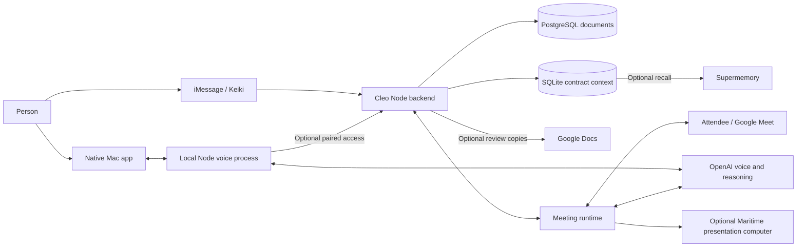

# How Cleo works

Cleo has three ways in: iMessage, a Google Meet, and a companion on your Mac. They share legal guidance and can share saved contract context, but they run through different services. The desktop doesn't send every spoken turn through the iMessage agent.

This describes the implementation in this checkout. It isn't a claim that every integration is configured or running in a particular deployment.

## The pieces



## iMessage and documents

Keiki runs the conversational agent and handles iMessage. Its instructions and tool definitions live in `config/cleo-instructions.md` and `config/cleo-skill-tools.json`. The tools call Cleo's HTTP backend, started by `scripts/start.ts`.

`src/server.ts` handles requests and access checks. `src/workflow.ts` connects the document, memory and meeting operations. The backend checks the webhook credential and provider-supplied sender identity; it does not let a model choose which user's files to read.

For an uploaded contract, `src/import-document.ts` reads the supported format and produces a Word baseline where conversion is needed. Original uploads are retained. PDF and older Office formats use external conversion tools included in the container. Conversion can lose layout, and unreadable files are refused rather than treated as complete text.

The agent proposes exact changes against a source version. `src/docx.ts` validates the source hash and wording, then generates actual Word tracked changes. `src/review-pdf.ts` creates a review PDF. New documents use `src/draft-docx.ts`. Stored outputs are returned through signed download links; Keiki handles the message and file delivery.

Google support is optional. `src/google-redline.ts` creates extracted-text review copies and verifies their original and proposed wording. `src/google-editing.ts` can add requested suggestions to a verified copy after checking its current revision. An uncertain write is recorded for inspection instead of blindly repeated. The configured Google account owns those copies; this prototype does not provide separate Google sign-in for every user. New users do not automatically get publicly shared Google Docs.

## On-screen Cleo

The desktop is a Swift app using AppKit, ScreenCaptureKit, Vision, AVFoundation and WebKit. Its entry point is `desktop/Sources/CleoDesktop/CleoApp.swift`.

The native app owns the microphone, speakers, screen capture, text recognition, floating companion, screen marks and sketchbook. A child Node process, `scripts/voice-sidecar.mjs`, runs the voice agent. They exchange bounded JSON messages through private process pipes, without opening a local web server.

A spoken interaction looks like this:

1. The user starts a session with Control-C or the menu action.
2. The native app sends microphone audio to the voice process, which connects to OpenAI Realtime through the Agents SDK.
3. At speech start, Cleo reads the visible window under the pointer. Vision recognizes the text locally. The voice model receives bounded text, not the screen image.
4. The model can request a fresh screen read, an exact passage mark, a sketch, or a deeper clause review.
5. Native code checks that the window, wording and target are still current before placing a mark. The model supplies text and line IDs, not unrestricted screen coordinates.
6. Speaker playback releases queued marks and drawings. Interruptions discard pending work so an old answer doesn't keep drawing over the next turn.

`src/voice-runtime.mjs` defines the tools and conversation. `src/voice-review.mjs` handles longer excerpt reviews through OpenAI Responses. Those review jobs belong to the current voice session and are cancelled when it ends.

The sketchbook is a local SVG canvas in a WebKit view. `desktop/NotepadWeb/book.mjs` and `canvas.mjs` are its sources; `renderer.js` is their generated bundle. Models submit bounded drawing plans. They do not supply executable JavaScript. Drawings persist while the app is running, and drawing pace follows response playback rather than individual spoken words.

The app's build records the checkout and Node executable paths. It is a development app that depends on those files, not a self-contained distributable. The [README](README.md#run-on-screen-cleo) covers setup.

## Memory and identity

`src/matter-context.ts` stores literal conversation events, contract mappings, export state and saved presentation records in SQLite. Access is scoped to a user and source document. `src/supermemory.ts` optionally indexes recorded messages for semantic recall in a separate namespace for each user/source pair. Local records remain available if that service fails.

The desktop uses `src/desktop-context-client.mjs` and a dedicated pairing token. The server binds that token to one configured user. The desktop can list and recall that user's contracts, save spoken instructions, and read or suggest changes to eligible Google review copies. It cannot select another owner by changing a tool argument.

`src/voice-context.mjs` binds a conversation to a selected contract. A supported browser's document identity can come from the native Accessibility reader, or the user can explicitly identify the contract or Doc link. Text recognized from a page is not trusted as browser identity.

Memory has limits. The iMessage agent must call the recording tools; the backend does not receive the entire message history automatically. On desktop, completed user transcriptions are saved after a contract has been selected. Unbound speech and assistant speech are not automatically saved as a full transcript. Memory supports an explanation; it does not replace the current document or establish what the user agreed to.

## Google Meet

Meeting attendance is an optional backend feature. The owner supplies an existing Google Meet link through an authenticated direct-message flow. Cleo does not create the link. `src/attendee.ts` connects to Attendee, and `src/meeting-transport.ts` handles the live session.

`src/meeting-session.ts` keeps the owner, source, selected passage, permissions and session state together. Joining does not itself authorize speaking or sharing. Controls are checked against the current session, including after asynchronous work finishes.

The meeting receives a saved document view: source wording, a generated draft, or a comparison with saved redlines. `src/meeting-presentation-model.ts` checks the saved artifact and constructs the allowed public fields. Prepare the draft or review before inviting Cleo; a source-only view is not a completed redline review, and an active meeting should not be assumed to pick up later edits.

Private owner notes are handled separately from participant-facing speech. `src/meeting-private-director.ts` can influence a limited direction or approve/reject a proposed response; it does not supply private text to the public voice model. Public explanations use the allowed document view and meeting dialogue. The controls are designed to prevent Cleo from accepting terms or committing on the owner's behalf.

`src/meeting-realtime.ts` handles spoken responses. Transcript filtering, turn state and audio pacing live in the surrounding `meeting-*` modules. When configured, `src/meeting-computer.ts` uploads a sanitized saved HTML snapshot to a separate Maritime computer for presentation. That browser receives the public document view, not the owner's private notes or Google credentials. `src/meeting-browser.mjs` is uploaded and executed there; it is not an ordinary local import.

## Storage and services

| Piece | Where it lives or runs |
| --- | --- |
| Imported documents, Word outputs and drafts | PostgreSQL through `src/store.ts`; SQLite through `src/local-store.ts` for local development |
| Contract context and export/presentation records | SQLite through `src/matter-context.ts` |
| Meeting state and diagnostic traces | SQLite through the meeting modules |
| Optional semantic recall | Supermemory |
| iMessage conversation and delivery | Keiki |
| Desktop and meeting voice; deeper reasoning | OpenAI |
| Meeting attendance and media transport | Attendee |
| Optional Google review copies | The configured Google account |
| Backend deployment and optional presentation computer | Maritime |
| Public website | React/Vite in `web/`, built into `dist/landing` and served by the backend |

The SQLite-backed parts assume a persistent disk and a single backend instance. They need shared storage or a different coordination design before running several backend instances. Contract context currently follows source-document identity; identical templates used for separate negotiations need a more explicit matter identity before broader use.

## Guidance, checks and deployment

`src/cleo-shared-policy.mjs` contains shared behavioral guidance. Desktop voice imports it; `scripts/sync-cleo-policy.mjs` refreshes its managed block in the iMessage instructions. `src/legal-skills.ts` exposes an allowlisted legal reference library with integrity checks. References guide the agent; loading one does not run a review or grant a new tool.

The repo includes third-party code and legal references with their own license and provenance files. Those notices are retained alongside the relevant material.

Useful local checks are:

```sh
npm run lint
npm run typecheck
npm test
npm run desktop:test
```

`npm test` first builds the website. Some document tests require the conversion programs used by the container. The native checks require a Mac. Automated checks don't establish real iMessage delivery, spoken interaction quality or a successful live meeting.

GitHub CI checks the backend, container/database path and Mac build. This repository does not include automation or credentials for an existing hosted deployment. Hosting requires your own infrastructure and provider configuration. The container can run the backend; Keiki must be configured separately using the instructions and tool definitions in `config/`. Service health alone does not prove the full user flow.

The larger legal services firm, lawyer routing, self-service onboarding and a complete retention/deletion interface are not implemented here.
